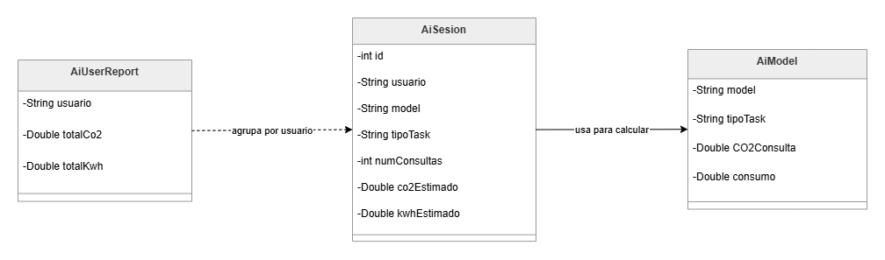
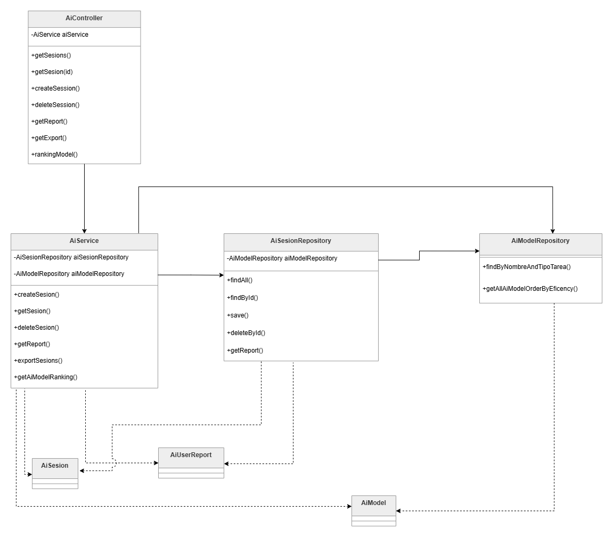
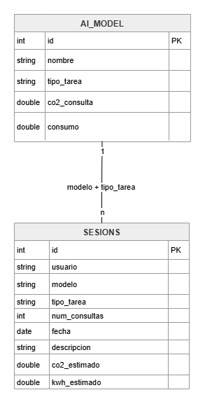

# Impacto de las IAs - Practica Final SpringBoot

## Índice

1. [Documento técnico del proyecto](#1-documento-técnico-del-proyecto)
   - 1.1 [Descripción general](#11-descripción-general)
   - 1.2 [Funcionalidad abierta del grupo](#12-funcionalidad-creativa)
   - 1.3 [Estructura del proyecto](#13-estructura-del-proyecto)
   - 1.4 [Documentación de los endpoints REST](#14-documentación-de-los-endpoints-rest)
   - 1.5 [Esquema de la base de datos](#15-esquema-de-la-base-de-datos)
   - 1.6 [Descripción técnica del cálculo de CO₂ y kWh](#16-descripción-técnica-del-cálculo-de-co2-y-kwh)

2. [Manual de usuario / Manual de integración](#2-manual-de-usuario--manual-de-integración)
   - 2.1 [Requisitos](#21-requisitos)
   - 2.2 [Instalación](#22-instalación)
   - 2.3 [Crear la base de datos](#23-crear-la-base-de-datos)
   - 2.4 [Configurar la conexión](#24-configurar-la-conexión)
   - 2.5 [Ejecución de la aplicación](#25-ejecución-de-la-aplicación)
   - 2.6 [Uso de la API](#26-uso-de-la-API)
   - 2.7 [Interpretación de resultados](#27-cómo-interpretar-los-resultados)

3. [Plan de pruebas (testing)](#3-plan-de-pruebas-testing)
   - 3.1 [Enfoque](#31-enfoque)
   - 3.2 [Master Test Plan](#32-master-test-plan)
   - 3.3 [Pruebas automatizadas en el código](#33-pruebas-automatizadas-en-el-código)
   - 3.4 [Cobertura manual vs automatizada](#34-cobertura-manual-vs-automatizada)

4. [Uso de la inteligencia artificial en el desarrollo](#4-uso-de-la-inteligencia-artificial-en-el-desarrollo)
   - 4.1 [Herramientas utilizadas](#41-herramientas-utilizadas)
   - 4.2 [Dónde se ha aplicado](#42-dónde-se-ha-aplicado)
   - 4.3 [Cómo se ha usado](#43-cómo-se-ha-usado)
   - 4.4 [Valoración crítica](#44-valoración-crítica)
  
5. [Trabajo en equipo y GitHub](#5-trabajo-en-equipo-y-github)
6. [Autores](#6-autores)
7. [Licencia y entrega](#7-licencia-y-entrega)

## 1. Documento técnico del proyecto

### 1.1 Descripción general

Hablamos de una API REST desarrollada con **Spring Boot** que registra sesiones de consultas de diferentes IAs (ChatGPT, Copilot, Stable Diffusion, etc.) y calcula el impacto ambiental aproximado de estas: emisiones de **CO₂** (gramos) y consumo energético (**kWh**) por sesión.

Se quiere hacer "tangible" el coste ambiental de estas consultas, que a menudo se reducen a preguntas cotidianas. Nuestra aplicación centraliza estos datos, los persiste en MySQL y ofrece consultas, informes por usuario y exportación de ellos.

### 1.2 Funcionalidad creativa

Hemos añadido el endpoint **`GET /modelRanking`**, que devuelve todos los modelos de la tabla `ai_model` ordenados por consumo energético por consulta: menos consumo por consulta, más arriba aparece en el ranking.

Nos ayuda a comparar qué herramientas son más eficientes en energía según los datos fijos de los modelos.

### 1.3 Estructura del proyecto

Arquitectura por capas:

```
src/
├── main/
│   ├── java/org/example/co2generatedbyai/
│   │   ├── controller/                      --> Peticiones HTTP (@RestController)
│   │   │   └── AiController.java
│   │   ├── service/                         --> Lógica de negocio
│   │   │   └── AiService.java
│   │   ├── repository/                      --> Acceso a MySQL con JdbcTemplate
│   │   │   ├── AiModelRepository.java
│   │   │   └── AiSesionRepository.java
│   │   └── model/                           --> Clases de dominio
│   │       ├── AiModel.java
│   │       ├── AiSesion.java
│   │       └── AiUserReport.java
│   └── resources/
│       └── application.properties
└── test/java/org/example/co2generatedbyai/
    ├── AiServiceMockitoTest.java
    ├── AiSesionTest.java
    └── ApplicationContextTest.java
```

| Capa | Responsabilidad | Clases principales |
|------|-----------------|-------------------|
| **Controller** | Recibe solicitudes, códigos HTTP, validaciones básicas | `AiController` |
| **Service** | Crear sesiones, informes, exportación CSV, ranking | `AiService` |
| **Repository** | SQL (CRUD, GROUP BY, consultas a `ai_model`) | `AiSesionRepository`, `AiModelRepository` |
| **Model** | Datos de dominio y cálculo de CO₂/kWh al crear sesión | `AiSesion`, `AiModel`, `AiUserReport` |

**NOTAS:** 

- No hemos creado una capa **DTO** separada. El JSON de la API usa directamente `AiSesion` (constructor vacío + setters para el POST). Y hemos creado la clase `AiUserReport`, para las respuestas del informe.

- Anotamos que, aunque el enunciado menciona Spring Data JPA, en este proyecto hemos elegido Spring JDBC (JdbcTemplate) para acceder a MySQL; ya que es lo practicado en clase.

- Estas dos decisiones han sido aceptadas por los profesores en el aula.

#### Relación entre clases




### 1.4 Documentación de los endpoints REST

**URL base:** `http://localhost:8080`

| Método | Ruta | Descripción | Cuerpo (JSON) | Respuesta |
|--------|------|-------------|---------------|-----------|
| GET | `/` | Comprobar que la API funciona | — | Texto plano |
| GET | `/sesions` | Listar todas las sesiones | — | 200 + Array de `AiSesion` |
| GET | `/sesions/{id}` | Obtener una sesión por id | — | 200 / 404 |
| POST | `/sesions` | Registrar nueva sesión | `AiSesion` | 201 + sesión creada / 400 |
| DELETE | `/sesions/{id}` | Borrar sesión | — | 204 / 404 |
| GET | `/sesions/report` | CO₂ y kWh totales por usuario | — | 200 + Array de `AiUserReport` |
| GET | `/sesions/export` | Exportar sesiones a CSV y devolver lista | — | 200 + fichero `exports/sesions.csv` |
| GET | `/modelRanking` | Ranking de modelos por eficiencia (consumo) | — | 200 + Array de `AiModel` ordenado |

Nuestras rutas usan `/sesions`, aunque en el enunciado dice `/sessions`. Pero el comportamiento es el mismo.

#### Ejemplo POST `/sesions`

**Request:**
```json
{
  "usuario": "Maria",
  "model": "GPT-4",
  "tipoTask": "texto",
  "numConsultas": 6,
  "fecha": "2026-05-19",
  "descripcion": "Redacción de informe"
}
```

**Response `201`:**
```json
{
  "id": 12,
  "usuario": "Maria",
  "model": "GPT-4",
  "tipoTask": "texto",
  "numConsultas": 6,
  "fecha": "2026-05-19",
  "descripcion": "Redacción de informe",
  "co2Estimado": 39.0,
  "kwhEstimado": 0.03
}
```

- Si falta `usuario` o `model` --> 400
- Si el modelo no existe en BD o `numConsultas <= 0` --> puede devolver 500
- Si no se envía `fecha` o `descripcion` --> se guardan por defecto la fecha de hoy y una cadena vacía como descripción

#### Ejemplo GET `/sesions/report`

**Response `200`:**
```json
[
  {
    "usuario": "Maria",
    "totalCo2": 78.0,
    "totalKwh": 0.06
  }
]
```

#### Ejemplo GET `/modelRanking`

Devuelve modelos ordenados por `consumo` ascendente (de menos a más consumo).

### 1.5 Esquema de la base de datos

**Base de datos:** `co2_by_ai`



Cada sesión se vincula a un registro de `ai_model` mediante `modelo` + `tipo_tarea` para obtener `co2_consulta` y `consumo`.

Aquí encontraréis el fichero para poder conseguir la Base de Datos creada y utilizada en esta aplicación: [Script de creación de la Base de Datos](docs/sql/co2_by_ai.sql)

### 1.6 Descripción técnica del cálculo de CO2 y kWh

Los valores de referencia se leen de `ai_model` según el nombre del modelo y el tipo de tarea.

Al crear una sesión, el constructor de `AiSesion` con `AiModel` calcula:

- CO₂ estimado (g): `numConsultas × co2_consulta`
- kWh estimado: `numConsultas × consumo`

**Ejemplo:** GPT-4, texto, 6 consultas, `co2_consulta = 6.5`, `consumo = 0.005`:
- CO₂ = 6 × 6.5 = **39.0 g**
- kWh = 6 × 0.005 = **0.03 kWh**

Estos valores se guardan en `sesions` y se agregan en el informe por usuario.

Aunque, en la cabezera de la tabla de datos enegéticos de los respectivos modelos proporcionado por el enunciado pone que las unidades energeticas son Wh, en los datos númericos de la misma tabla vemos que las unidades son kWh.

## 2. Manual de usuario / Manual de integración

Este apartado explica cómo instalar, ejecutar y probar la API en local. No hay interfaz gráfica: la aplicación se usa mediante Postman, curl o cualquier cliente HTTP.

### 2.1 Requisitos

- JDK 25
- Maven
- MySQL 8 en ejecución (puerto 3306)
- Postman o curl

### 2.2 Instalación

1. Descargar el archivo Source code (zip) del Release.
2. Descomprimir la carpeta en tu equipo.
3. Abrir la carpeta en un IDE.

### 2.3 Crear la base de datos

Ejecuta el script del proyecto en MySQL Workbench, DBeaver o la consola de MySQL:

[`docs/sql/co2_by_ai.sql`](docs/sql/co2_by_ai.sql)

El script crea la base `co2_by_ai`, las tablas `ai_model` y `sesions`, e inserta los modelos de referencia de los modelos de IA.

### 2.4 Configurar la conexión

Edita `src/main/resources/application.properties`:

```
spring.application.name=CO2generatedByAI
spring.datasource.url=jdbc:mysql://localhost:3306/co2_by_ai
spring.datasource.username=root
spring.datasource.password=TU_PSWD
```

Si MySQL usa otro puerto (ej. 3307), cámbialo en la URL: `localhost:3307/co2_by_ai`.

### 2.5 Ejecución de la aplicación

Al ejecutar `Co2byAiApplication.java`, si todo va bien, verás en consola que la aplicación ha arrancado.

La API queda disponible en: **http://localhost:8080**

Para comprobar que funciona, abre en el navegador o en Postman:

```
GET http://localhost:8080/
```

> Respuesta esperada: `CO2 generado por IA - API funcionando`

Opcionalmente puedes ejecutar los tests automatizados ubicados en:

```
└── test/java/org/example/co2generatedbyai/
    ├── AiServiceMockitoTest.java
    ├── AiSesionTest.java
    └── ApplicationContextTest.java
```

### 2.6 Uso de la API

**URL base:** `http://localhost:8080`

### Crear una sesión

Registra una sesión de IA. El sistema calcula automáticamente el CO₂ y el kWh a partir de la tabla `ai_model`.

Los campos son: 

```
{
  "usuario": "Maria",
  "model": "GPT-4",
  "tipoTask": "texto",
  "numConsultas": 6,
  "fecha": "2026-05-20",
  "descripcion": "Redacción de informe"
}
```

Importante:
- El nombre del modelo debe existir en `ai_model`.
- El tipo de tarea debe coincidir con los valores de la Base de Datos.
- Si no se envía un valor para `fecha`, se usa la fecha de hoy.
- Si no se envía un valor para `descripcion`, se guarda este campo vacío.

```
curl -X POST http://localhost:8080/sesions \
  -H "Content-Type: application/json" \
  -d "{\"usuario\":\"Maria\",\"model\":\"GPT-4\",\"tipoTask\":\"texto\",\"numConsultas\":6,\"descripcion\":\"Prueba desde curl\"}"
```

**Respuesta esperada:** `201 Created`

```json
{
  "id": 1,
  "usuario": "Maria",
  "model": "GPT-4",
  "tipoTask": "texto",
  "numConsultas": 6,
  "fecha": "2026-05-20",
  "descripcion": "Prueba desde curl",
  "co2Estimado": 39.0,
  "kwhEstimado": 0.03
}
```

### Listar todas las sesiones

```
curl http://localhost:8080/sesions
```

**Respuesta:** `200 OK` con un array JSON de sesiones.

### Obtener una sesión por ID

```
curl http://localhost:8080/sesions/1
```

- Si la sesión existe --> `200 OK`
- Si la sesion no existe --> `404 Not Found`

### Eliminar una sesión

```
curl -X DELETE http://localhost:8080/sesions/1
```

- Si es eliminada correctamente --> `204 No Content`
- Si el id marcado es inexistente --> `404 Not Found`

### Informe de impacto por usuario

```
curl http://localhost:8080/sesions/report
```

Devuelve el CO₂ y el kWh acumulados por cada usuario.

### Exportar sesiones

```
curl http://localhost:8080/sesions/export
```

- Respuesta HTTP: `200 OK` con la lista de sesiones en JSON.  
- Además, se genera el fichero **`exports/sesions.csv`** en la carpeta del proyecto (una fila por sesión).

### Ranking de eficiencia de modelos

```
curl http://localhost:8080/modelRanking
```

Devuelve los modelos de `ai_model` ordenados por consumo energético por consulta.

### 2.7 Cómo interpretar los resultados

### `POST /sesions`: Crear una sesión

- `co2Estimado`: Gramos de CO₂ estimados para toda la sesión
- `kwhEstimado`: kWh estimados para toda la sesión
- `id`: Identificador asignado en la base de datos

Fórmulas (por sesión):

- **CO₂ (g)**: `numConsultas × co2_consulta` del modelo  
- **kWh**: `numConsultas × consumo` del modelo  

### `GET /sesions/report`: Generar informe

Cada elemento del JSON representa un usuario. Sirve para comparar qué usuarios acumulan más impacto ambiental en el uso de IA.

### `GET /sesions/export`: Exportación

- **En la respuesta HTTP:** ves los mismos datos que en el listado, en JSON.  
- **Con files:** el CSV en `exports/sesions.csv` te permite tenerlo en local.

Las columnas del CSV siguen el orden: id, usuario, model, tipoTask, numConsultas, fecha, descripcion, co2Estimado, kwhEstimado.

### `GET /modelRanking`: Ranking

Lista de los modelos de IA, no las sesiones de usuarios. El primero de la lista es el que consume menos energía por consulta.

Útil para elegir herramientas más eficientes; no indica calidad del modelo, solo el criterio energético definido en el proyecto.

## 3. Plan de pruebas (testing)

### 3.1 Enfoque

Las pruebas a que hemos llevado a cabo en el proyecto se han enfocado en test unitarios para comprovar que los cálculos del código sean correctos, y en test Mockito y manuales [(Master Test Plan)](docs/MasterTestPlan_AImpact.xlsx) para comprovar el funcionamiento correcto de la API.

### 3.2 Master Test Plan

El master Test plan consiste en las  siguientes pruebas:

| **ID** | **Nombre del Test** | **Descripción** | **Tester** | **Fecha** | **Resultado** |
|-------|----------------------|-----------------|------------|-----------|----------------|
| 1 | POST /sesions - Crear sesión válida | Verificar que se crea una sesión correctamente y se calcula el CO₂ y kWh automáticamente | Julio Arango | 19/05/2026 | P |
| 2 | GET /sesions - Listar todas las sesiones | Verificar que se listan todas las sesiones almacenadas en la BD | Julio Arango | 19/05/2026 | P |
| 3 | GET /sesions/{id} - Obtener sesión por ID | Verificar que se obtiene una sesión concreta por su ID y se gestiona correctamente el caso de ID inexistente | Julio Arango | 19/05/2026 | P |
| 4 | DELETE /sesions/{id} - Eliminar sesión | Verificar que se elimina correctamente una sesión y se gestiona el caso de ID inexistente | Julio Arango | 19/05/2026 | P |
| 5 | GET /sesions/report - Reporte CO₂ por usuario | Verificar que el reporte agrupa correctamente el CO₂ y kWh total por usuario | Julio Arango | 19/05/2026 | P |
| 6 | GET /sesions/export - Exportar CSV | Verificar que se exporta correctamente un fichero CSV con todas las sesiones | Julio Arango | 19/05/2026 | P |
| 7 | POST /sesions - Validación datos incorrectos | Verificar que se validan correctamente los datos incorrectos y se devuelve HTTP 400 | Julio Arango | 19/05/2026 | P |
| 8 | Cálculo CO₂ y kWh - Tests unitarios JUnit | Verificar que los tests unitarios de cálculo de CO₂ y kWh pasan correctamente con JUnit | Julio Arango | 19/05/2026 | P |
| 9 | GET /modelRanking - Ranking modelos por eficiencia | Verificar que devuelve modelos ordenados de menor a mayor CO₂/consulta | Julio Arango | 19/05/2026 | P |

### Resumen
**Tests totales:** 9  
**Resultado:** PASS 9/9

### 3.3 Pruebas automatizadas en el código

Para la pruebas automatizadas en el codigo usamos los frameworks Junit en los test de AiSesion y Mockito en los test de AiService.

**Test en AiSesion:**
Los test que se hicieron en AiSesion estan categorizados por dos propositos: comprocion de claculos y comprovacion de excepciones/control de errores.
En total se hicieron:

| **Nombre del Test** | **Descripción** | **Resultado Esperado** | **Estado** |
|---------------------|-----------------|-------------------------|------------|
| maria_co2Estimado | Cálculo correcto del CO₂ estimado para María | CO₂ = 39.0 | PASS |
| maria_kwhEstimado | Cálculo correcto del kWh estimado para María | kWh = 0.03 | PASS |
| julio_co2Estimado | Cálculo correcto del CO₂ estimado para Julio | CO₂ = 43.75 | PASS |
| julio_kwhEstimado | Cálculo correcto del kWh estimado para Julio | kWh = 0.06 | PASS |
| copiaDatosDesdeAiModel | Verifica que los datos del modelo se copian correctamente a la sesión | Modelo = GPT-4, Tipo = texto, Usuario = Maria, Consultas = 6 | PASS |
| modeloNull_lanzaExcepcion | Validación: modelo nulo debe lanzar excepción | IllegalArgumentException con mensaje "No existe modelo de referencia" | PASS |
| ceroConsultas_lanzaExcepcion | Validación: número de consultas igual a 0 debe lanzar excepción | IllegalArgumentException con mensaje "No se pueden hacer sesiones sin numero de consultas" | PASS |
| consultasNegativas_lanzaExcepcion | Validación: consultas negativas deben lanzar excepción | IllegalArgumentException | PASS |

**Test en AiService:**

Los test que se hicieron en AiService se centran en comprobar que las sesiones se creen, eliminen, muestren en el formato correcto. Tambien se comprueva si el metodo para obtener el ranking funciona.

Resumen de los test:

| **Nombre del Test** | **Descripción** | **Resultado Esperado** | **Estado** |
|---------------------|-----------------|-------------------------|------------|
| createSesion_devuelveCo2Calculado | Crear una sesión y calcular automáticamente CO₂ y kWh | Usuario = Maria, CO₂ = 39.0, kWh = 0.03 | PASS |
| getSesion_existe_devuelveSesion | Obtener una sesión existente por ID | Devuelve sesión con usuario = Maria | PASS |
| getSesion_noExiste_devuelveNull | Intentar obtener una sesión inexistente | Devuelve null | PASS |
| deleteSesion_existe_devuelveTrue | Eliminar una sesión existente | Retorna true | PASS |
| deleteSesion_noExiste_devuelveFalse | Intentar eliminar una sesión inexistente | Retorna false | PASS |
| getAiModelRankingTest | Obtener ranking de modelos por eficiencia | Retorna lista aiModelRanking | PASS |

### 3.4 Cobertura manual vs automatizada

Como podeis ver los test de cobertura manual se centraron más en las capas interiores del sistema (AiService y AiSesion) mientras que lo test manuales se centraron mas en la capa exterior (AiController). 

Ahora, tanto en los tests manuales como en los tests automaticos comprobamos el funcionamiento de `POST`, `GET` y `DELETE`.

## 4. Uso de la inteligencia artificial en el desarrollo

### 4.1 Herramientas utilizadas

Durante el desarrollo del proyecto hemos utilizado las siguientes herramientas de IA:

- **Claude** (Anthropic)
- **ChatGPT** (OpenAI)

### 4.2 Dónde se ha aplicado

Las herramientas de IA se han utilizado en las siguientes partes del proyecto:

- Depuración y resolución de errores
- Configuración del proyecto (application.properties, pom.xml)
- Diseño visual del Master Test Plan
- Diseño visual de la presentación

### 4.3 Cómo se ha usado

**Consultas técnicas e investigación:**
Se usó para resolver dudas sobre Spring Boot, JdbcTemplate, arquitectura por capas y Git. Por ejemplo, entender la diferencia entre JPA y JdbcTemplate, o cómo estructurar correctamente las ramas de trabajo.

**Resolución de errores:**
Fue clave para identificar errores concretos durante el desarrollo. El más relevante fue detectar que el constructor de `AiSesion` no se deserializaba correctamente al recibir el JSON del `POST /sesions` — la solución fue añadir la anotación `@JsonCreator` al constructor vacío para indicarle a Spring qué constructor usar al procesar el JSON entrante.

**Documentación y diseño:**
Se usó para para diseñar el esquema visual de la presentación del proyecto y el Master Plan test.

**Adaptación de resultados:**
En todos los casos, los resultados generados por la IA se han revisado, adaptado y validado por el equipo antes de integrarse en el proyecto. No se ha copiado código directamente sin entenderlo.

### 4.4 Valoración crítica

**Qué ha funcionado bien:**
- Agilizar la resolución de errores que habrían costado mucho más tiempo buscando en documentación oficial.
- Obtener explicaciones claras de conceptos nuevos como `@JsonCreator`, `JdbcTemplate` o el flujo de ramas con Git.
- Generar una ayuda de diseño visual para el Master Test Plan y la presentación que luego hemos personalizado.

**Dónde ha habido que corregir la IA:**
- En algunas ocasiones sugería soluciones con JPA cuando nosotras habíamos decidido usar JdbcTemplate — había que redirigir la consulta especificando nuestra decisión técnica.
- Algunos fragmentos de código generados no encajaban directamente con nuestra estructura de clases y había que adaptarlos.

## 5. Trabajo en equipo y GitHub

El desarrollo se ha hecho en el repositorio de la práctica, con ramas por funcionalidad e integración en la rama `dev`.

Utilizamos **GitHub Projects** para planificar tareas, asignar responsables y hacer seguimiento del estado del trabajo:  [Tablero del proyecto](https://github.com/orgs/LSG-Programacio/projects/7)

Respectivo al flujo de trabajo:

- Cada funcionalidad relevante se trabaja en una **rama** y se integra en `dev` mediante merge.
- Los **commits** siguen la notación de Conventional Commits.

## 6. Autores
Julio Arango <br>
Lucía Martínez <br>
Maria Montobbio <br>

## 7. Licencia y entrega
Este proyecto es con fines educativos para el ciclo formativo de La Salle Gràcia | DAM.

**Módulo:** 
- 0485: Programació (RA5, RA8, RA9)
- 0486: Entorns de desenvolupament (RA3)
- 0487: Sostenibilitat aplicada al sistema productiu (tots els RAs)

Release / tag: []
